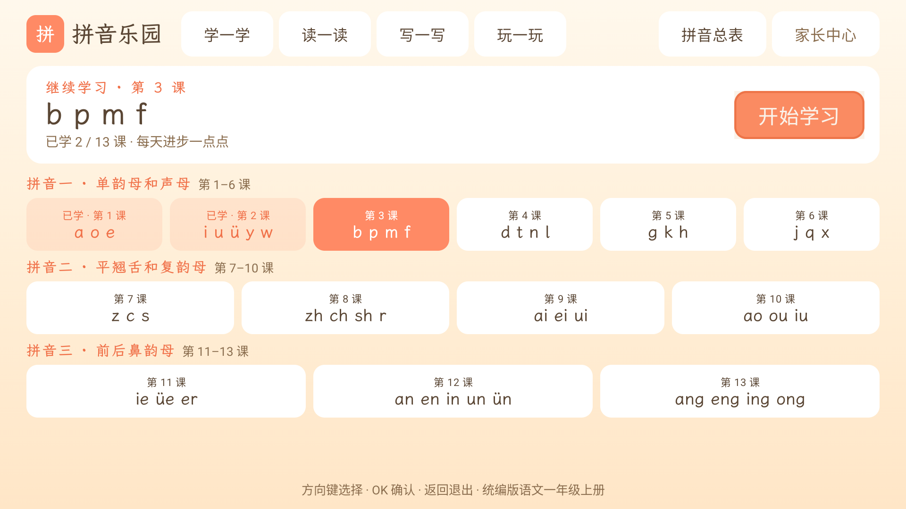
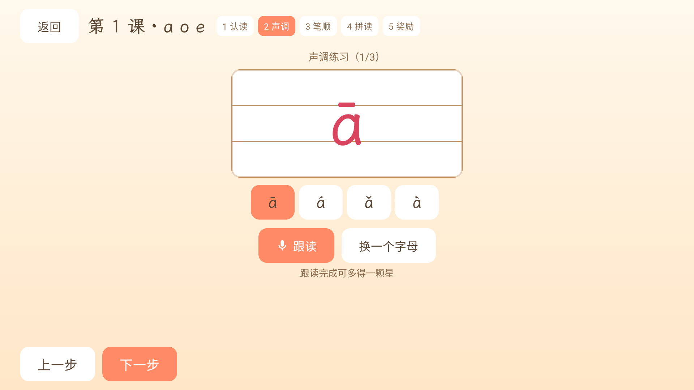
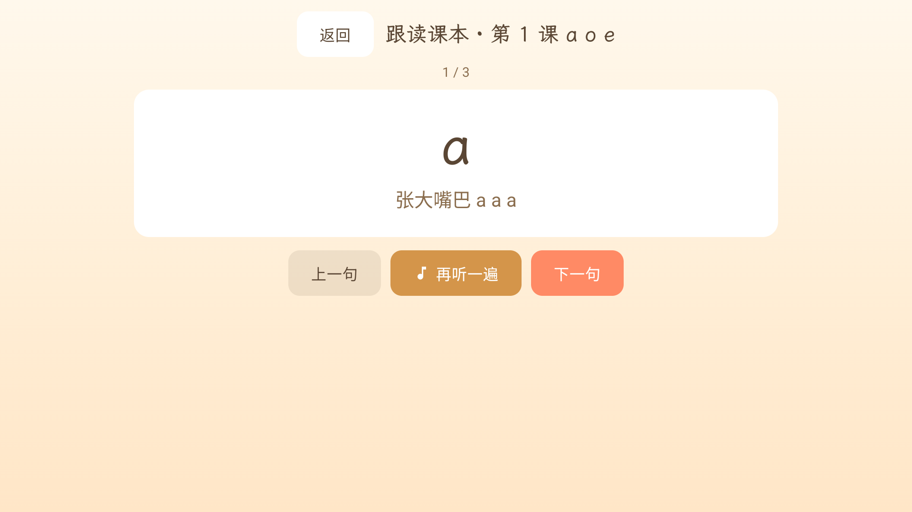
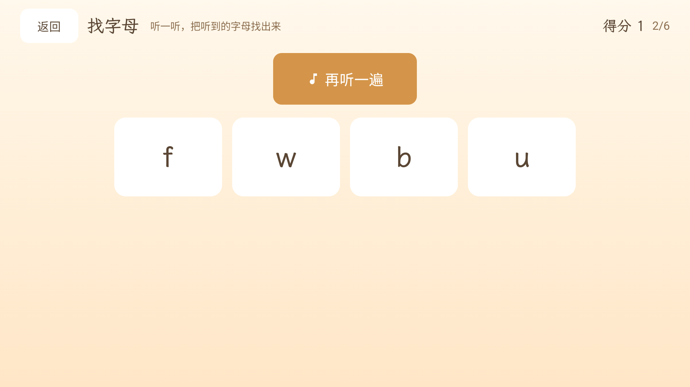
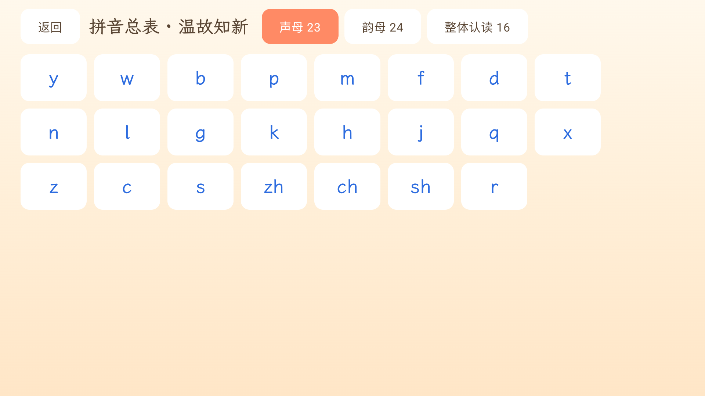
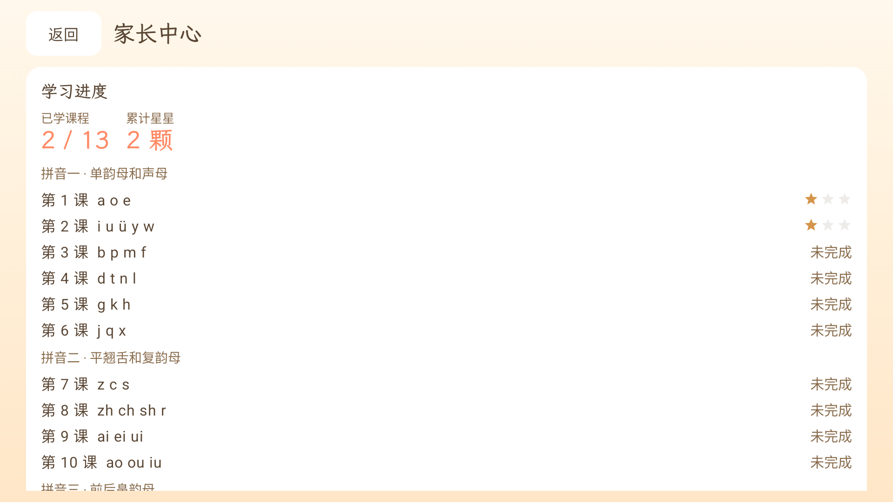

# 拼音乐园

<a href="LICENSE"></a>   

**拼音乐园**是一款面向 6–7 岁一年级学生的拼音学习应用，课程内容依据 **2024 统编版语文一年级上册**的三个拼音单元（共 13 课、47 个字母、16 个整体认读音节）编写。

以 **Android TV 为主要场景**（遥控器方向键操作），同时适配**平板横屏触控**；全部课程数据与语音资源随包内置，**完全离线**可用。

## ✨ 功能特性

- **学一学**：每课五步走——认读 → 声调 → 笔顺 → 拼读 → 奖励，学习进度与星级自动保存；
- **写一写**：47 个字母在四线格中逐笔演示笔顺（Canvas + PathMeasure 动画），支持单步查看与自动演示；
- **读一读**：跟读课本（每课字母与口诀逐句跟读）、词句跟读（40 个常用词）；
- **玩一玩**：找字母（听音选字母）、选声调（听音选声调）两个小游戏，随机出题；
- **拼音总表**：声母 23 · 韵母 24 · 整体认读 16，点击即读，温故知新；
- **家长中心**：逐课查看已学课程与累计星星，内置 20 分钟护眼提醒开关；
- **双端适配**：TV 遥控器 D-pad 焦点导航与平板触控两套交互，触控端字号自动缩小一档；
- **完全离线**：预打包儿童声语音包（单声道 Opus），无需联网、不依赖系统 TTS。

## 📸 截图预览

| 首页 | 学一学 · 声调练习 |
| --- | --- |
|  |  |
| **写一写 · 笔顺演示** | **读一读 · 跟读课本** |
|  |  |
| **玩一玩 · 找字母** | **拼音总表** |
|  |  |
| **家长中心** | |
|  | |

## 📚 教材内容

| 单元 | 课程 | 字母 |
| --- | --- | --- |
| 拼音一 · 单韵母和声母 | 第 1–6 课 | a o e ／ i u ü y w ／ b p m f ／ d t n l ／ g k h ／ j q x |
| 拼音二 · 平翘舌和复韵母 | 第 7–10 课 | z c s ／ zh ch sh r ／ ai ei ui ／ ao ou iu |
| 拼音三 · 前后鼻韵母 | 第 11–13 课 | ie üe er ／ an en in un ün ／ ang eng ing ong |

## 🛠 技术栈

- **语言 / UI**：Kotlin + Jetpack Compose（Material 3 + AndroidX TV），全屏均为 Compose 实现；
- **架构**：`domain`（课程/进度/出题器/笔顺领域模型）+ `data`（课程资源、DataStore 进度与设置）+ `ui`（界面）分层；
- **关键依赖**：Navigation Compose、DataStore Preferences、kotlinx.serialization、AndroidX TV（compileSdk 37 / minSdk 24）；
- **音频**：随包内置离线语音包（逐行台词预合成，多音字经同音字替换处理），`tools/` 内提供台词生成与 Opus 转码脚本；
- **字体**：[霞鹜文楷](https://github.com/lxgw/LxgwWenKai)（子集化后随包内置）；
- **测试**：52 个单元测试覆盖出题器、学习进度、笔顺拆解等领域逻辑。

## 🚀 构建与运行

环境要求：JDK 17+，Android SDK（Android Studio 或命令行均可）。

```bash
# 克隆
git clone https://github.com/<your-name>/xuepinyin.git
cd xuepinyin

# 编译 Debug APK
./gradlew :app:assembleDebug

# 安装到已连接的设备 / 模拟器
adb install -r app/build/outputs/apk/debug/app-debug.apk

# 运行单元测试
./gradlew :app:testDebugUnitTest
```

也可以直接从 [Releases](../../releases) 页面下载已签名的 APK 安装。

> Release 签名需要本地准备 `release.keystore` 与 `keystore.properties`（两者均已 gitignore，不入库），日常使用 Debug 构建即可。

## 📁 项目结构

```
app/src/main/java/com/rakor/xuepinyin/
├── audio/        # 语音包播放器
├── data/         # 课程资源读取、进度与设置存储（DataStore）
├── domain/       # 领域模型：课程、学习进度、游戏出题器、笔顺
├── ui/           # Compose 界面（home / lesson / write / read / play / table / parent / theme）
└── MainActivity.kt
app/src/main/assets/
├── lessons.json  # 13 课课程数据
├── audio/        # 逐行 Opus 语音
└── voicepack/    # 语音包清单
tools/            # 语音内容生成、字体子集化等 Python 脚本
docs/             # 设计文档与截图
```

## 📄 许可证

本项目代码以 [MIT License](LICENSE) 开源。

- 内置字体 [霞鹜文楷（LXGW WenKai）](https://github.com/lxgw/LxgwWenKai)采用 SIL Open Font License 1.1 授权；
- 课程内容依据公开出版的统编版语文教材目录编写，仅供家庭教育与学习交流使用，与教材出版方无关。
